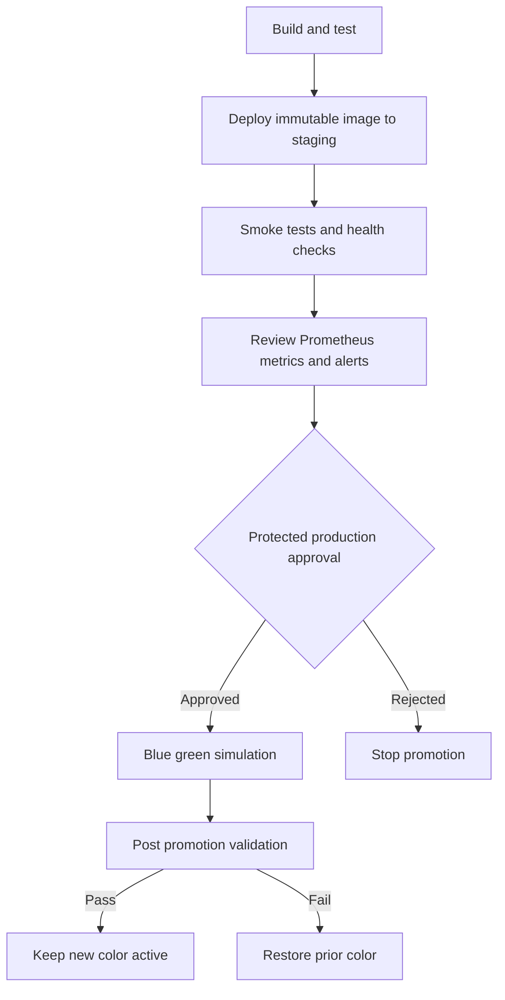

# Mini Project 2.4 release governance

## Release sequence

The existing pipeline builds and tests each change. Only a successful push to
`main` starts the staging deployment. That workflow uses the immutable image
produced by CI, deploys it to Render, waits for the platform to report `live`,
then runs the calculator, CSRF, health, revision, and metrics smoke checks.
Any failed deploy or smoke check fails the staging workflow and leaves no
successful candidate for promotion.

After those checks, the staging workflow runs Prometheus against the actual
Render service for a short window. It records the observed process uptime,
request counters, latency, error rate, readiness, revision match, and active
critical alerts. A missing target, unhealthy readiness state, revision mismatch,
or active critical alert fails the staging workflow.

The `MP2.4 Monitoring Validation` workflow is a separate evidence check for the
exact candidate revision. It runs app tests, validates Prometheus and
Alertmanager configuration, verifies Prometheus can scrape the app, and
confirms both notification routes reach their local test receivers. The
promotion workflow checks this result and successful staging evidence before
the protected environment approval.

The pull-request report is collected from the isolated CI app, not from Render.
On 2026-11-22, a read-only check of the configured `STAGING_URL`
(`https://itsd-4350-staging.onrender.com`) returned HTTP 404 for both
`/health/ready` and `/metrics`, so live monitoring of the candidate was not
verified. The staging deployment workflow only runs after a successful push to
`main`; no Render deployment was made during this review.

## Approval and promotion

Mini Project 2.3's `Production Blue Green Simulation` is an isolated simulation
on an ephemeral GitHub Actions runner. It is not a real production deployment.
It verifies the successful staging run and exact image digest before switching
traffic, tests the selected revision, and exercises rollback by stopping the
candidate container. The previous color remains available for recovery during
the drill.

The existing workflow includes a manual dispatch and an explicit approval
input. The promotion job references the `production-simulation` environment,
but the repository currently has only a `staging` environment. Until required
reviewers are configured, the dispatch input is only a manual acknowledgment,
not an enforced reviewer gate.

To enable the gate, open repository **Settings  Environments  New environment**,
create `production-simulation`, select **Required reviewers**, add an
independent reviewer, optionally enable **Prevent self-review**, and save the
protection rules. Limit deployment branches to `main`. Confirm the new
environment appears in the list before relying on it. Repository administrators
configure this setting; a workflow file cannot create the reviewer rule.

Before dispatching, the release operator checks that the run ID, candidate SHA,
staging image digest, smoke-test evidence, and matching monitoring run are all
for the same revision. The designated environment reviewer independently
reviews that evidence and the rollback procedure before approving the isolated
simulation. A rejected review or any failed validation blocks the job.

## Release blockers

- CI, required quality checks, staging deployment, or staging smoke tests fail.
- The staging run does not match the candidate revision or is not successful.
- Readiness fails, `/metrics` is unavailable, or monitoring shows an active
  critical alert.
- The selected image digest does not match the one tested in staging.
- No successful staging run exists for the exact candidate revision, or the
  matching monitoring-validation run is missing or failed.
- A protected environment reviewer rejects the release.
- Post-promotion health or calculator checks fail; restore the previous color.

## Alert routing and escalation

Prometheus evaluates availability, readiness, 5xx ratio, and latency alerts.
Alertmanager sends notifications to SMTP and a webhook. The local integration
stack routes these to Mailpit and a local webhook capture service so both
delivery paths can be tested without contacting external recipients. Real
staging notification delivery still requires owner-provided SMTP/webhook
settings and a verification run in that environment. Review active alerts and
failed staging checks before approving any candidate. Treat a critical alert
as an immediate release stop and escalate it to the environment reviewer and
repository owner. Review warning alerts and their supporting metrics before
approval; do not approve while a warning remains unexplained.

## Rollback

Use the existing `bluegreen/manage.py rollback` controller or let the
blue/green simulation restore the previous color after a failed check. Verify
the stable endpoint reports the previous revision, then inspect container logs
and the workflow's uploaded evidence. For the isolated simulation, follow
[`bluegreen/ROLLBACK.md`](bluegreen/ROLLBACK.md). Do not treat a simulation
rollback as proof of production recovery.

